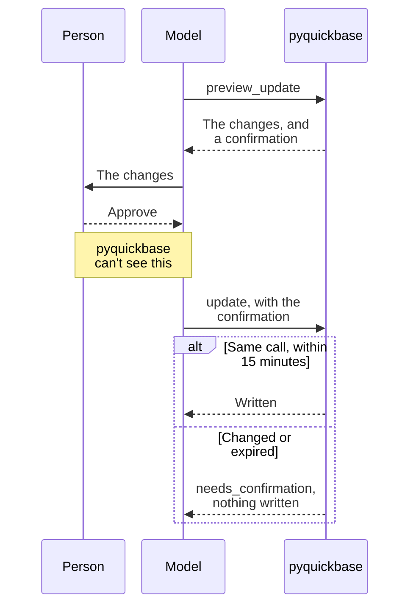

# Previews, writes, and schema changes

## Checking a change before making it

### Requiring the preview

Telling a model to preview first isn't enough: in testing, a model updated a record without a preview,
or any approval. With `require_preview=True`, the `update` and `delete` operations only run with the
`confirmation` that `preview_update` or `preview_delete` returned, for exactly the same arguments:

```python
from pyquickbase import tool_result

preview = tasks.operation("preview_update")
update = tasks.operation("update", require_preview=True)
arguments = {"records": [{"Record ID#": 1, "Status": "Done"}]}

shown = tool_result(preview.run(arguments))  # holds "confirmation"
# ... the person approves what the preview showed ...
update.run({**arguments, "confirmation": shown["confirmation"]})
```

- **The arguments must match.** The order of records, and of fields in a record, doesn't matter, but
  any other difference refuses the call, so a model can't preview one change and make another.
- **A confirmation lasts 15 minutes.**
- **A delete's confirmation holds how many records matched**, so the delete is refused if that has
  changed since the preview. A preview of more records than the delete may match gives no confirmation.
- **It's signed with a key each client makes when it starts**, so nothing is stored, a model can't make
  one up, and the preview and the change must come from the same client. Give them the same `scope`.



It makes sure a preview happened, not that a person saw it. Ask your client to show each change for
approval too.

### Previews without operations

Have a tool show what it would do, and make the change only once someone has approved it. A preview only
reads, so the tool that shows it can use a read-only client, and only the tool that writes needs more.

```python
from pyquickbase import F, Policy, Quickbase, tool_result, where_from_dict


def preview_status_change(record_id: int, status: str) -> dict:
    """The tool the model calls first. It changes nothing."""
    with Quickbase.from_env(policy=Policy.read_only()) as qb:
        tasks = qb.app("bq1234567").table("Tasks")
        preview = tasks.preview_update([{"Record ID#": record_id, "Status": status}])
    return tool_result(preview)


def preview_delete_tasks(project: str, where: dict) -> dict:
    """Shows how many tasks a delete would remove, and the first few."""
    with Quickbase.from_env(policy=Policy.read_only()) as qb:
        tasks = qb.app("bq1234567").table("Tasks")
        condition = (F("Project") == project) & where_from_dict(where, fields=["Status"])
        page = tasks.preview_delete(condition, select=["Title"], limit=10)
    return tool_result(page)
```

The delete preview's `page.total` is how many tasks the delete would remove. Add `tool_error()` as in
[Returning results to a model](results.md#returning-results-to-a-model) to return a refusal too.

The values in a preview are record data, so treat them as [untrusted](results.md#reading-results), and only return
fields the model should see. A preview isn't a guarantee, as records can change before the write, and
[it doesn't check](../guides/writing.md#previewing-a-write) whether Quickbase will accept it. Compare a delete's
result with the preview's `total`, and tell the user if they differ.

## Changing the schema from an agent

`app.operation()` offers three schema tools. `describe_schema` lists the tables and fields the client
can read. `preview_schema_changes` says what a list of changes would do. `apply_schema_changes` makes them, but only with
the `confirmation` that `preview_schema_changes` returned for exactly those changes, within 15 minutes, while the
schema is as it was. Unlike `require_preview` for records, this can't be turned off.

```python
from pyquickbase import AsyncQuickbase, Policy, allow, tables, tool_result

policy = Policy(
    rules=[
        allow.read("Tasks"),
        allow.schema(
            "Tasks",
            "add_field",
            "change_field",
            "formula",
            field_types=["text", "numeric", "date", "checkbox", "text-multiple-choice"],
        ),
        allow.create_tables(),
        allow.read(tables.created()),
        allow.schema(tables.created(), "add_field", "change_field", "delete_field"),
    ]
)
async with AsyncQuickbase.from_env() as setup:
    bound = await policy.bind(setup.app("bq1234567"))
async with AsyncQuickbase.from_env(token_env="QB_SCHEMA_TOKEN", policy=bound) as qb:
    app = qb.app("bq1234567")
    describe = await app.operation("describe_schema")
    plan = await app.operation("preview_schema_changes", max_changes=10)
    apply = await app.operation("apply_schema_changes", max_changes=10)
    # What a model sends, such as adding a text field to Tasks.
    arguments = {
        "changes": [{"action": "create_field", "table": "Tasks", "label": "Crew", "type": "text"}]
    }
    shown = tool_result(await plan.run(arguments))  # holds "confirmation" if nothing blocks it
```

A change names what it does in `action`, such as `create_field`, `create_lookup_field`, or
`create_summary_field`, and a relationship's tables in `child_table` and `parent_table`. A summary's
`function` is `sum`, `avg`, `min`, `max`, `count`, `std_dev`, `distinct_count`, `combined_text`, or
`combined_user`. `run()` also reads what models tend to send instead: `kind` for `action`,
`create_lookup` and `create_summary`, `child` and `parent`, and Quickbase's own function names, such
as `SUM` or `STD-DEV`, or words like `total` and `average`. The result lists each change with its
`status`: `ready`, `already_done`, or `blocked`.

- **Each schema offers only what the policy allows:** the actions, the tables that can change, and
  the field types they can create. A plan reports anything the policy would refuse as a blocker,
  so the person sees it before approving.
- **Each change is granted where it lands.** A lookup is granted on the child, and needs `read` on
  the parent's field. A summary is granted on the parent, and needs `read` on the child's field and
  `filter` on the fields its filter uses. A relationship needs both tables, as it adds fields to the
  parent too.
- **Formulas, lookups, and summaries may only use fields the client can already read.** A formula
  can't call a function that reads other records, such as `GetRecords()`. It can't make a link or rich
  text, which act as whoever clicks them. A field's formula is only shown when everything it uses is
  readable, and a summary's filter when every field it uses is readable on the child.
- **A plan says what the policy would do with each change,** in its `policy_effects`: who could read
  and write a new field, the classes a new formula, lookup, or summary would get, and which rules lose
  a deleted field or table. A deletion that would leave a rule matching nothing is a blocker, and so
  is a label a field the client can't see already uses.
- **Tables the client creates are covered by `tables.created()`.** Creating one gives the client a
  new policy that includes it, so a table the model creates is off limits unless a rule names
  `tables.created()` or `tables.all()`.
- **Use a separate token for schema changes.** Changing the schema needs more rights than reading and
  writing records, so keep those on a token with less.
- **A confirmation is signed with the client's key, and tied to its policy.** Give clients in several
  processes the same `confirmation_key`, and the same bound policy, if a plan may be applied by
  another one.

A plan's `tool_result()` has `plan.changes`, each with its `summary`, `risk`, `settings`, `warnings`,
`blockers`, any `policy_effects`, and a `link` to check it in Quickbase, then `blockers`, `warnings`, `confirmation`, and
`expires_at`. Show the person the summaries and warnings, and send `apply_schema_changes` the same changes with
the confirmation once they approve. It makes sure a plan happened, not that a person saw it, so ask
your client to show each change for approval too.

## Writes

Quickbase writes the rows it can and reports the rest, so a failed write can still have changed
data. Check `WriteError`, which [lists both](../guides/writing.md#when-rows-fail):

```python
from pyquickbase import WriteError

try:
    result = tasks.insert(rows)
except WriteError as error:
    print("Written:", error.result.created_ids)
    for failed in error.result.errors:
        print("Failed:", rows[failed.index], failed.messages)
```

Rate limits, connection failures, and reads that timed out are retried for you. A write that timed out
isn't, because it
may already have applied, so an agent should check the data before trying again.

| Exception | What it means for a write |
|---|---|
| [Mistakes caught before sending](../guides/errors.md#mistakes-caught-before-sending), such as `QueryError`, `InvalidValueError`, and `PolicyRefusedError` | This request wasn't sent |
| `WriteError` | Some rows may have been written. If a large write stopped at a later batch, `result` covers only the earlier batches, `errors` can be empty, and the failed batch may have been written |
| `NetworkError`, `RequestTimeoutError`, `ServerError`, `InvalidResponseError` | Unknown, so check the data first |
| Other `APIError`s, such as `BadRequestError` | Quickbase answered with an error, so fix the cause rather than repeating the request |

`create_field()` with `required` or `unique` takes two requests, so if it raises an error, the field
[may already exist](../guides/schema.md). This includes `PolicyRefusedError`, when only the first is allowed.

Repeating an `update()`, or an `upsert()` on a unique field, reports the record as unchanged rather
than adding another, but repeating an `insert()` can add a duplicate.
