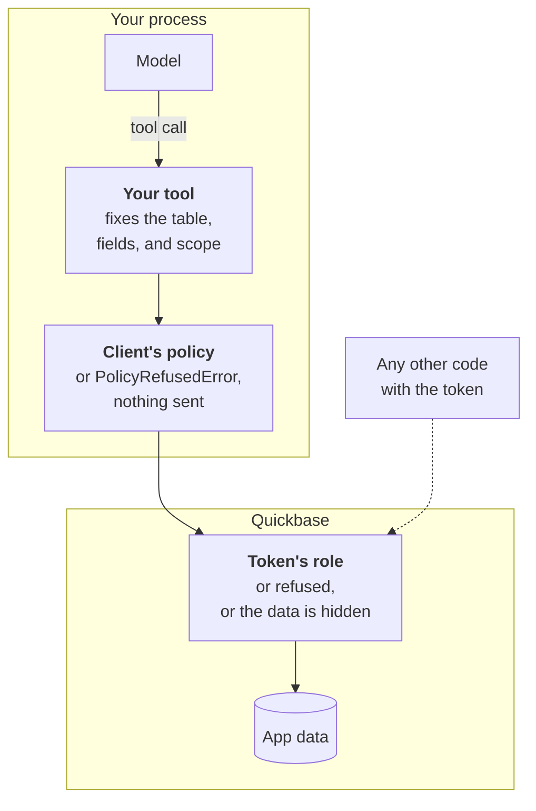

# Using pyquickbase from an AI agent

This guide is for developers who let an AI agent use the SDK, and for agents reading these docs.

An agent can write a query or a delete from text it didn't choose, such as a user's message or a
record it just read. The raw REST API accepts many of the resulting mistakes without an error.
`DELETE /records` treats a lowercase operator as "contains", and a value of `_FID_6` in
`{6.EX.'_FID_6'}` [deleted every record](../api-notes.md#query-pitfalls) in a test table.

The SDK catches those mistakes, but what an agent may do is up to you. The docs are also available
as [llms.txt](../llms.txt), a list of the pages, and [llms-full.txt](../llms-full.txt), all of them
in one file.

## A safe starting point

Give the agent small functions rather than the client. Your code fixes the table, fields, and
operators, and the model only supplies values.

```python
from pyquickbase import F, Policy, Quickbase


def open_tasks(project: str) -> list[dict]:
    """A tool for the agent, which only chooses `project`."""
    if not project.strip():
        raise ValueError("A project is required.")
    with Quickbase.from_env(policy=Policy.read_only()) as qb:
        tasks = qb.app("bq1234567").table("Tasks")
        where = (F("Project") == project) & (F("Status") == "Open")
        return [dict(task) for task in tasks.query(where=where, select=["Title"], max_total=50)]
```

## Limiting access

Give an agent a client with a [policy](../policies/index.md) that allows only
what its job needs. [`Policy.read_only()`](../reference/policies.md#Policy-read_only) is the place to start, and it only sends GET requests,
record queries, report runs, and formula runs. If the agent also needs to write, or shouldn't see
everything the token can, write a [`Policy`](../reference/policies.md#Policy) and bind it to the app. Anything it doesn't allow raises
[`PolicyRefusedError`](../reference/errors.md#PolicyRefusedError) and is never sent, which also applies to [`qb.request()`](../reference/client.md#Quickbase-request). The SDK enforces it
itself, so it doesn't depend on the model following its instructions.

```python
from pyquickbase import Policy, Quickbase, allow, deny, fields, tables

policy = Policy(
    tags={"internal": ["Tasks.Amount", "Tasks.Code", fields.labeled_like("Old*")]},
    rules=[
        # It can read everything but costs and codes, 50 records at a time, add tasks, and
        # change two of their fields. It can't delete anything.
        allow.read(tables.all(), max_paging_depth=50),
        allow.insert("Tasks", fields.all()),
        allow.update("Tasks", ["Status", "Notes"]),
        deny.all(fields.tagged("internal")),
    ],
)
with Quickbase.from_env() as setup:
    bound = policy.bind(setup.app("bq1234567"))
agent_client = Quickbase.from_env(policy=bound)
```

[Try it in the playground](../playground-app/index.html#limit-what-an-agent-can-do), with simulated data.

To the agent, a field or table the policy hides looks as if it doesn't exist. [`table.fields()`](../reference/fields.md#Table-fields) leaves
it out, and naming it raises [`UnknownFieldError`](../reference/errors.md#UnknownFieldError). Anything else it refuses raises
`PolicyRefusedError`, whose message says what was refused, by name, which rule refused it, and what
would allow it, without the values it sent. Return either one to the model as the tool's result, with
[`tool_error()`](results.md#errors).

- **A tag carries over to what's built from it.** A formula, lookup, or summary of a field in a
  tag is in the tag too, so denying the tag hides them all, whatever table they're on.
- **Fields added after binding are read-only,** and follow the policy's `new_fields`, until you bind
  again.
- **[`limit.rows()`](../reference/rules.md#limit-rows) keeps it to some records,** by ANDing a condition onto every query, summary, and
  delete the client sends, and checking the records each update names. It's defense in depth behind
  the role's record-level rules.
- **Email addresses are left out** of user values, and the uploader's details out of file values,
  unless a rule that reads the table passes `user_emails=True`.
- **Formulas are refused** unless the policy is `Policy.read_only()`, because a formula can read any
  table and field.

You can add checks of your own, such as a limit on how many records one call can change, with a
[rule of your own](../policies/custom-rules.md), which can only refuse.

See [what a policy doesn't do](../policies/limits.md#from-an-agents-side), including what
these limits can't stop an agent doing.

## The token is the real boundary

A token has its user's permissions, through their role, so Quickbase enforces that limit whichever
code is running.

Each layer checks a request on its own, so a mistake or a manipulated model has to get past all of
them:



The first two run in your process, and the role is enforced by Quickbase, whichever code is running.

- Use a token whose user has a role with only the access the agent needs, and give the token access
  to as few apps as possible. Use a sandbox app while you're trying things out.
- Use [`Quickbase.from_env()`](../reference/client.md#Quickbase-from_env) rather than putting a token in code or a prompt. This keeps it away
  from the model, but not from code the agent runs in the same environment.
- Temporary tokens are deliberately [not in the SDK](../api-notes.md#temporary-tokens).

Test the role you plan to use, because this has only been partly confirmed. A
[view-only role](../api-notes.md#restricted-users) was refused every write we tried, and fields it
couldn't see were left out. A [role with write access](../api-notes.md#roles-with-write-access) was
held to its limits as well, and a formula can't read a table its
[role has no access to](../api-notes.md#restricted-users). That result is empty, not an error, so an
empty result doesn't mean there's no data.
[Record-level rules](../api-notes.md#record-level-rules) held too, for reads, formulas, and writes, but
they only check a record before a change. A role can move a record it may modify to where it can no
longer see it, and can add a record it won't be able to read.
