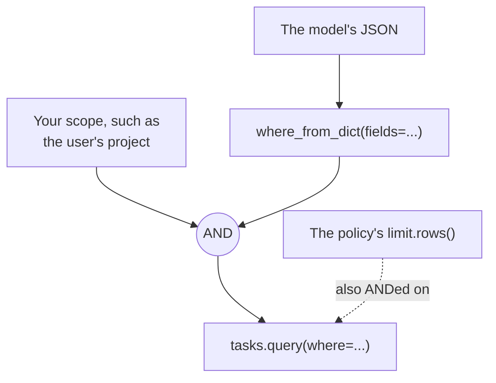

# Untrusted input

## Untrusted values

Use [`F`](../guides/reading.md#writing-queries) for a value a model or user supplied, or
[`where_from_dict()`](#filters-from-a-model) if they also choose the filter, and never build a `where`
string from it. The SDK can't tell an added condition from one you meant to write, so a
`code` of `zz'}OR{3.GT.'0` makes the second line below [match every
record](../api-notes.md#query-pitfalls):

```python
tasks.delete(F("Code") == code)  # Raises QueryError for that value
tasks.delete(f"{{6.EX.'{code}'}}")  # Don't do this
```

`F` escapes quotes and backslashes, and handles the text that Quickbase would read as query syntax:

- A value containing `{` or `}` raises `QueryError`.
- A value like `_FID_6` raises `QueryError`.
- A standalone uppercase `OR` or `AND` is sent in lowercase, so `a OR b` finds that text rather than
  matching `a` and `b`. Comparisons ignore case, so it still finds a stored `a OR b`.
- Anything other than text, a number, a date, a boolean, or None raises `QueryError`, and so does a
  `datetime` without a timezone.

That protects the shape of a query, not its meaning:

- **Empty values match empty fields.** `F("Code") == ""` and `F("Code") == None` match every record
  with no code, so check that a value isn't empty first, especially before a delete.
- **A model that chooses the field or operator chooses the result.** `F("Status") != "x"` is a valid
  query that matches almost everything. Fix these in your code.
- **`delete()` requires `where`,** so leaving it out can't delete everything, but a broad condition
  still can. Call [`preview_delete()`](changes.md#checking-a-change-before-making-it) with the same condition first,
  and compare its `total` with what you expect.

!!! note "`_curuser_` and relative dates"
    On a `user` or `multiuser` field, Quickbase reads `_curuser_` as the token's owner, ignoring case
    and surrounding spaces, so a value from someone else could match the owner's records. `F` raises
    `QueryError` for it there. On a text field it's literal text, so `F` allows it.

    On a date field, Quickbase reads text such as `today` or `1 day ago` as a date. That gives a
    model nothing it couldn't get by naming the date, but text it can't read matches nothing, with no
    error. Convert dates to `date` objects, so a bad one fails right away.

[Try it in the playground](../playground-app/index.html#search-with-text-you-dont-control), with simulated data.

## Filters from a model

When a model needs to choose its own filters, have it send JSON, and don't let it write query strings.
For a tool that runs one table operation, [`table.operation()`](operations.md#giving-a-model-operations) does this for
you, with the schema and the check built together. Use these two directly for anything else, such as a
web form's filters.
This works the same with MCP and any other LLM tool system, because they all describe a tool's input
with JSON Schema. `where_schema()` provides that description, and `where_from_dict()` checks what
comes back.

```python
from pyquickbase import F, Policy, Quickbase, where_from_dict, where_schema

FILTERABLE = ["Status", "Due Date", "Amount"]

SEARCH_TOOL_INPUT = {
    "type": "object",
    "properties": {"where": where_schema(fields=FILTERABLE)},
    "required": ["where"],
}


def search_tasks(project: str, where: dict) -> list[dict]:
    """The tool. Your code fixes the table, the project, and the fields it may filter on."""
    with Quickbase.from_env(policy=Policy.read_only()) as qb:
        tasks = qb.app("bq1234567").table("Tasks")
        condition = (F("Project") == project) & where_from_dict(where, fields=FILTERABLE)
        return [dict(task) for task in tasks.query(where=condition, select=["Title"], max_total=50)]
```

The model only supplies part of the filter. Your code fixes the rest, and a policy adds its own:



Return a `QueryError` or `UnknownFieldError` to the model as the tool's result, with
[`tool_error()`](results.md#errors). Their messages say where the mistake is and what's allowed, so it can correct
itself, and they don't repeat the values it sent. Nothing has been sent to Quickbase at that point.

`where_from_dict()` refuses these rather than guessing what was meant:

| Refused | Because |
|---|---|
| An unknown key or operator, or a condition without `value` | A dropped key would otherwise become a search for empty fields. Send `null` to mean that |
| A string for `in`, such as `"abc"` | It would search for `a`, `b`, and `c` |
| An empty value with anything but `==`, `!=`, `in`, or `not_in`, or a value of only whitespace | What these match isn't clear |
| Text on a date, such as `today`, or a time without a time zone | Quickbase matches nothing, with no error, for text it can't read as a date |
| Anything but a number on a number, and anything but true or false on a checkbox | The query would run, and mean something else |
| `IR` and `XIR` | They take date ranges as text. Compare with dates instead |
| Over 100 conditions, counting each value of `in` and `not_in`, or groups over 20 levels deep | A filter shouldn't need them, and they cost memory and time |
| Whatever `F` refuses, such as `_FID_6`, braces, and `_curuser_` on a user field | Quickbase reads these as query syntax |

What it can't do is decide whether a filter is the right one:

- **Fix the scope in your code.** Combine it with `F`, as above, so that every query stays inside the
  project. Without that, a filter of `Record ID# > 0` matches every record, as it should.
- **Pass `fields` to limit what it can filter on.** Otherwise a model can learn the value of a field
  you didn't select, by filtering on it and seeing which records come back. `where_schema()` only
  tells the model the list, so pass the same list to `where_from_dict()`, which enforces it. A client's
  policy enforces what it may filter on as well, on every query.
- **Keep the schema small.** A tool's schema goes to the model with every request. The default covers
  `A and (B or C)` at about 700 tokens, and `max_depth=1` takes it to about 450 if a tool doesn't need
  that.
  Offering a whole table's labels adds to it, since they're repeated in each copy of a condition, so
  list only the fields a tool needs.
- **Treat labels as untrusted.** Passing `fields` shows their labels to the model, and a label can hold
  any text, so only offer fields from an app you trust.
