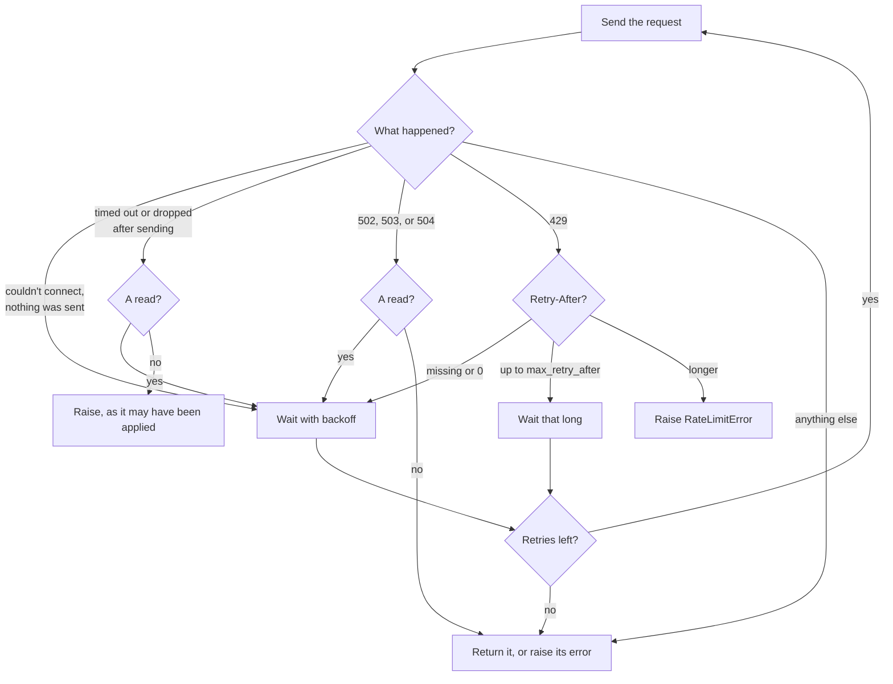

# Configuring clients

This page covers choosing a client, limiting what it can read and write, retries, and connection
settings. `Quickbase` and `AsyncQuickbase` take the same options. Use them as context managers so that
connections get closed.

## Sync or async

```python
import asyncio

from pyquickbase import AsyncQuickbase, F, Quickbase

with Quickbase(realm="acme", token="your_user_token") as qb:
    print(qb.app("bq1234567").table("Tasks").count(F("Status") == "Open"))


async def main() -> None:
    async with AsyncQuickbase(realm="acme", token="your_user_token") as qb:
        tasks = qb.app("bq1234567").table("Tasks")
        async for task in tasks.query(where=F("Status") == "Open", max_total=5):
            print(task["Title"])


asyncio.run(main())
```

The clients have the same methods, and the sync client is a true sync client rather than a wrapper
around asyncio. That means it works in notebooks, in threads, and inside a running event loop.
One sync client can be shared across threads. The async client works with both asyncio and Trio.

[Try it in the playground](../playground-app/index.html#use-the-async-client), with simulated data.

## Using several tokens

`Quickbase.from_env()` reads `QB_REALM` and `QB_USER_TOKEN`. A program with more than one token can
name the variable, such as a setup token and a restricted one:

```python
qb = Quickbase.from_env(token_env="QB_SERVICE_TOKEN")
```

## Limiting what a client can do

A client takes one `policy`, which says what it may read and change, such as
`Policy.read_only()`. Every request is checked before it's sent. See [Policies](../policies/index.md)
for how to write one, and what it does and doesn't protect against.

## Retries

```python
from pyquickbase import Quickbase, RetryPolicy

policy = RetryPolicy(max_retries=2, base_delay=0.5, max_delay=10, max_retry_after=30)
qb = Quickbase(realm="acme", token="your_user_token", retry=policy)
```

`max_retry_after` is the longest `Retry-After` the client will wait for. Past that, it raises
`RateLimitError`. A `Retry-After` of 0 uses the backoff from `base_delay` instead, because Quickbase
can send it while still limiting. Use `max_retries=0` to disable retrying.

What's retried:




| Failure | Reads | Writes |
|---|---|---|
| 429, rate limited | Yes | Yes |
| Couldn't connect, or no free connection in the pool | Yes | Yes, as nothing was sent |
| A timeout or dropped connection after sending | Yes | No, as it may have been applied |
| 502, 503, or 504 | Yes | No |
| Any other error status | No | No |

Reads are GET requests, record queries, report runs, and formula runs. Running a report again adds to its usage count again.

`timeout` applies to each step of a request separately, connecting, sending, and waiting for each part of
the response, as httpx does, rather than to the whole request.

## Using another API host

`base_url` sets the API root, which is `https://api.quickbase.com/v1` by default. The right host for EU
realms hasn't been confirmed, so pass `base_url` if yours differs. It must use HTTPS, except for
loopback addresses.

## Proxies, TLS, and logging

Pass your own [httpx](https://www.python-httpx.org/) client for proxies, custom TLS, event hooks, or
custom transports. You remain responsible for closing it.

```python
import httpx
from pyquickbase import Quickbase

http_client = httpx.Client(proxy="http://proxy.internal:8080")
qb = Quickbase(
    realm="acme",
    token="your_user_token",
    user_agent="my-app/1.0",
    http_client=http_client,
)
```

Tokens are kept out of `repr`s, exceptions, and logs, and the client refuses to send them over plain
HTTP, except to your own machine.

## Calling any endpoint

For endpoints without a dedicated method, `request()` returns the decoded JSON body.

```python
reports = qb.request("GET", "/reports", params={"tableId": "bq7654321"})
```
