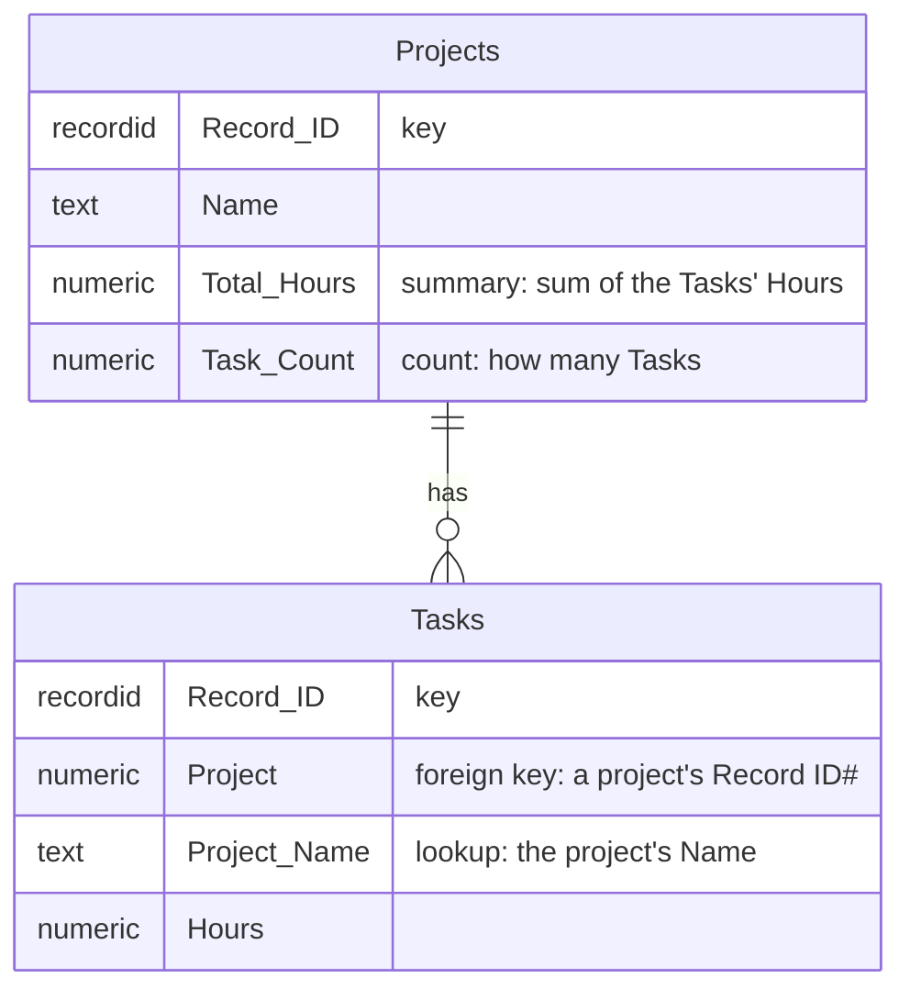
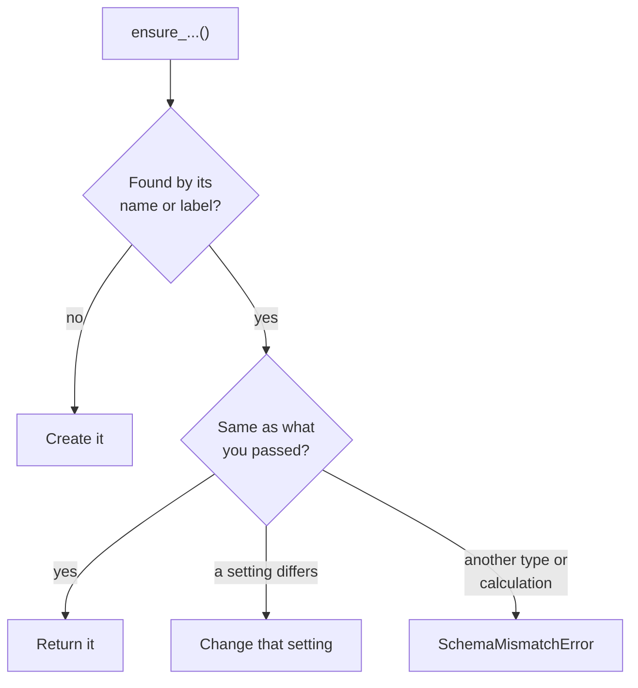
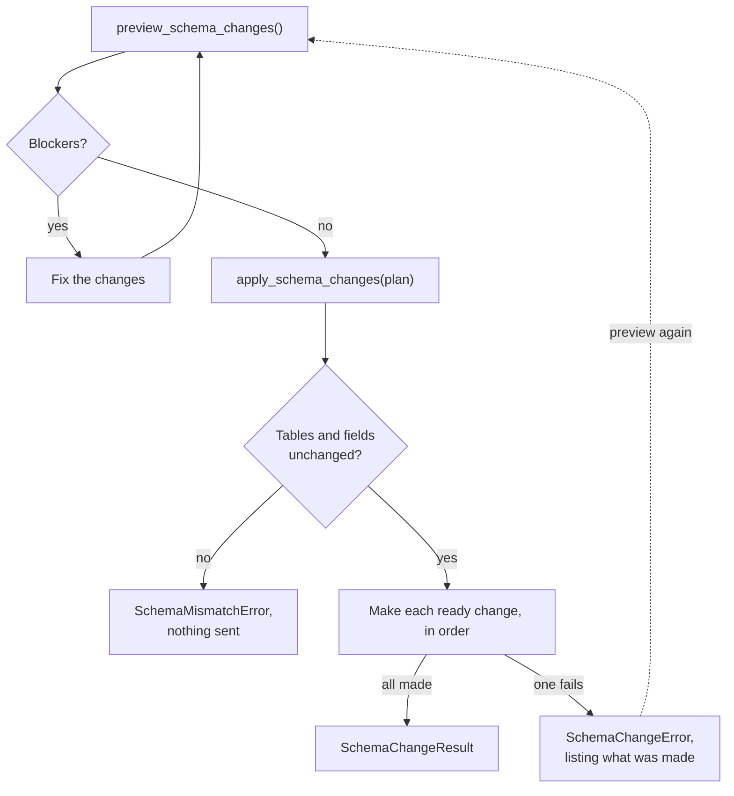

# Changing the schema

This page covers creating and changing tables, fields, and relationships. Every method here is also
on the async client, where you `await` it. To stop a client from changing the schema, see
[Limiting what a client can do](../policies/index.md).

## Creating a table and its fields

`create_table()` returns the new table, and `create_field()` takes a label and a
[field type](../field-types.md).

```python
from pyquickbase import Quickbase

with Quickbase(realm="acme", token="your_user_token") as qb:
    app = qb.app("bq1234567")

    projects = app.create_table(
        "Projects", single_record_name="Project", plural_record_name="Projects"
    )
    projects.create_field("Name", "text")
    projects.create_field("Status", "text-multiple-choice", choices=["Active", "Done"])
    projects.create_field("Budget", "currency", properties={"decimalPlaces": 2})
    projects.create_field("Score", "numeric", formula="1 + 1")
```

The other examples on this page use `qb`, a client made in the same way.

- `choices` are the options of a `text-multiple-choice` or `multitext` field. Quickbase refuses them on
  other types. **They don't restrict what can be written** unless you also pass
  `properties={"allowNewChoices": False}`, because a new field accepts new choices by default.
- `properties` are any other settings, sent as they are. The
  [field types page](../field-types.md#field-settings) lists common ones.
- `formula` makes it a formula field. See [Formulas](formulas.md#formula-fields).
- `help_text`, `bold`, `no_wrap`, `find_enabled`, `appears_by_default`, and `add_to_forms` are the
  settings Quickbase takes beside `properties`. See [Field settings](../field-types.md#field-settings).

To run the same script more than once, use the `ensure_` methods in
[Setup scripts you can run again](#setup-scripts-you-can-run-again).

## Making a field required or unique

Quickbase sets `required` and `unique` in a second request, after creating the field. If that request
fails, the field exists without them, so run `ensure_field()` to repair it once the problem is fixed.

```python
tasks = qb.app("bq1234567").table("Tasks")

tasks.create_field("Serial", "text", unique=True)
tasks.update_field("Title", required=True)
```

What's already in the table decides whether Quickbase allows this:

| Setting | When Quickbase refuses it |
|---|---|
| `required=True` | Any record has this field empty. **That includes every new field on a table with records**, so create the field, fill it in, and then make it required |
| `unique=True` | The field already holds duplicate values. A new, empty field is allowed |

Inserting a record without a required field's value then raises `WriteError`.

## Linking tables with a relationship

Call `create_relationship()` on the child table and pass the parent. This example makes each task
belong to a project.

```python
app = qb.app("bq1234567")
projects = app.table("Projects")
tasks = app.table("Tasks")

link = tasks.create_relationship(projects, foreign_key="Project", lookup_fields=["Name"])
```

| Field | Table | What it is |
|---|---|---|
| `Project` | Child | The foreign key, a `numeric` field holding the parent's record ID |
| `Project - Name` | Child | A lookup for each of `lookup_fields`, named after the foreign key and the field |
| `Task records` | Parent | A list of the child's records, named after the child's record name |
| `Add Task` | Parent | A link to add a child record |

- `lookup_fields` are the parent's fields. `link.lookup_field_ids` lists the lookups that resulted,
  which are on the child, so don't pass one back in.
- `tasks.relationships()` lists a relationship. `projects.relationships()` doesn't, because Quickbase
  only lists one on its child.
- Calling `create_relationship()` again makes another relationship, even with the same label.
  `ensure_relationship()` finds the existing one.

[Try it in the playground](../playground-app/index.html#follow-links-between-tables), with simulated data.

## Adding lookups and summaries

Use these two methods to add to a relationship, including one that already exists. Call both on the
child table.

- `ensure_lookup_field()` shows a parent's field on the child.
- `ensure_summary_field()` calculates a value from the child's records, and puts it on the parent.
- `ensure_count_field()` counts the child's records, and puts the count on the parent.



Every method is called on the child, but a summary or count is created on the parent.

```python
app = qb.app("bq1234567")
projects = app.table("Projects")
tasks = app.table("Tasks")

link = tasks.ensure_relationship(projects, foreign_key="Project")
tasks.ensure_lookup_field(link, "Name", label="Project Name")

tasks.ensure_field("Hours", "numeric")
tasks.ensure_summary_field(link, "Hours", "Total Hours")
tasks.ensure_summary_field(link, "Hours", "Longest Task", function="max")
tasks.ensure_count_field(link, "Task Count")
projects.ensure_field("Hours Or Zero", "numeric", formula="Nz([Total Hours])")
```

`function` defaults to `sum`. Quickbase's own names, such as `STD-DEV`, work too, and a field's
`summary_function` reads back in Quickbase's spelling:

| `function` | Worked on | The summary's type |
|---|---|---|
| `sum` | `numeric`, `currency` | The same as the child's field |
| `avg`, `std_dev` | `numeric` | `numeric` |
| `max`, `min` | `numeric`, `date` | The same as the child's field |
| `distinct_count` | `numeric`, `text` | `numeric` |
| `combined_text` | `text` | `multitext` |
| `combined_user` | `user` | `multiuser` |

We tested these combinations, and others may work. Quickbase refused `sum` of a `checkbox` and `max` of
`text`, with `BadRequestError`. `count` takes no field, so it has its own method, `ensure_count_field()`,
and `ensure_summary_field()` raises `InvalidValueError` for it.

**A summary with no child records is empty, not 0**, except a count, which is 0. Code that expects a number should read a formula
that uses `Nz()`, such as `Hours Or Zero` in the example here, rather than the summary.

### Summarizing only some child records

Pass `where` to either method to combine only the child records that match. It's a condition on the
child table, built with `F` or written as a string, as in a query:

```python
tasks.ensure_summary_field(link, "Hours", "Open Hours", where=F("Status") == "Open")
tasks.ensure_count_field(link, "Done Tasks", where="{9.EX.'Done'}")
```

- **The filter is checked before anything is sent.** Quickbase saves a filter it can't use, such as one
  with a typo or a field that doesn't exist, without an error, and the summary then always reads as
  empty. The SDK raises `QueryError` instead.
- **It's part of what makes a summary the same.** If a summary with that label exists with a different
  filter, or none, the method raises `SchemaMismatchError`. `Field.summary_query` holds a summary's
  filter.
- **On a client with a policy,** the filter may only use fields the client can filter on, since the
  summary shows how many records match. A summary's filter is shown only when every field it uses is
  readable on the child, and then an existing summary is compared with it. Otherwise `summary_query`
  is None, and an existing summary is matched without its filter.
- **A child with a row limit gets it in the filter.** The policy's `limit.rows()` for the child is
  ANDed into the filter, so the summary counts only what the client may reach, and an existing
  summary of that child whose filter doesn't hold the limit is hidden.
- **Deleting a field a filter uses** stops the summary working. A plan lists it with the summaries that
  stop working.
- `CreateSummaryField` takes the same `where`, as a string.

[Try it in the playground](../playground-app/index.html#watch-computed-fields-update), with simulated data.

## Setup scripts you can run again

The `ensure_` methods return what's there and create only what's missing, so a script can stop partway
and be run again.

```python
app = qb.app("bq1234567")

projects = app.ensure_table("Projects")
projects.ensure_field("Name", "text")
projects.ensure_field("Code", "text", unique=True)

tasks = app.ensure_table("Tasks")
tasks.ensure_field("Hours", "numeric")

link = tasks.ensure_relationship(projects, foreign_key="Project")
tasks.ensure_lookup_field(link, "Name", label="Project Name")
tasks.ensure_summary_field(link, "Hours", "Hours Sum")
projects.ensure_field("Total Hours", "numeric", formula="Nz([Hours Sum])")
```



| Method | Finds what's there by | If it exists |
|---|---|---|
| `ensure_table()` | Its name, ignoring case | Returns it unchanged |
| `ensure_field()` | Its label, ignoring case | Changes only what you passed that differs, including `formula`. Raises `SchemaMismatchError` rather than changing its type |
| `ensure_relationship()` | The parent, and the foreign key's label ignoring case | Returns it unchanged |
| `ensure_lookup_field()` | The parent's field it points at, so a renamed lookup is still found | Applies `label` if you passed one |
| `ensure_summary_field()` | Its label on the parent, ignoring case | Returns it. Raises `SchemaMismatchError` if that field isn't this same summary, with the same `where` |
| `ensure_count_field()` | Its label on the parent, ignoring case | Returns it. Raises `SchemaMismatchError` if that field isn't a count of this relationship, with the same `where` |

`required=True` in `ensure_field()` follows
[the same rules as anywhere else](#making-a-field-required-or-unique), so a script that adds a required
field to a table with records needs to fill it in first.

## Changing a field

`update_field()` changes only what you pass, and takes a label or an ID. If Quickbase refuses, the
field stays as it was.

```python
tasks = qb.app("bq1234567").table("Tasks")

tasks.update_field("Notes", label="Comments")
tasks.update_field("Status", properties={"choices": ["Open", "Done", "Blocked"]})
```

- `choices` in `properties` replaces the whole list, so include the ones you want to keep.
- `formula` only works on a formula field, and can't be blank, because Quickbase would accept that and
  empty the field's values.
- It can't change a field's type. Create a new field instead.

## Deleting fields and tables

```python
tasks = qb.app("bq1234567").table("Tasks")

tasks.delete_fields(["Old Field", "Older Field"])
tasks.drop(confirm="Tasks")
```

`delete_fields()` deletes the fields' data too. It raises `WriteError` if any field couldn't be
deleted, such as a built-in field, **though the others in the list will have been**. If one doesn't
exist, it raises `UnknownFieldError` and deletes nothing.

`drop()` deletes the table and all its records, so it requires the table's exact name.

## Planning changes before making them

`preview_schema_changes()` checks a list of changes against the app as it is, and says what each would do without
making it. `apply_schema_changes()` then makes them, in order, if the app hasn't changed since.

```python
from pyquickbase import CreateField, CreateRelationship, CreateSummaryField, DeleteField

app = qb.app("bq1234567")
plan = app.preview_schema_changes(
    [
        CreateField(table="Tasks", label="Due", type="date"),
        CreateRelationship(child_table="Tasks", parent_table="Projects", foreign_key="Project"),
        CreateSummaryField(
            child_table="Tasks", foreign_key="Project", label="Total Hours", child_field="Hours"
        ),
        DeleteField(table="Tasks", field="Old Notes"),
    ]
)
for change in plan.changes:
    print(change.status, change.risk, change.summary, change.warnings)
if not plan.blockers:
    app.apply_schema_changes(plan)
```

Each `PlannedChange` has:

- **`status`:** `ready`, `already_done` if the app already has it, or `blocked`.
- **`risk`:** `additive`, `modifying`, or `destructive`.
- **`settings`:** each setting it would set, before and after.
- **`warnings`:** what else it would do. For example, deleting a field lists how many records lose a
  value and which formulas, lookups, and summaries use it.
- **`blockers`:** why it can't be applied. Examples are a label already in use, empty values on a
  field being made required, duplicates on one being made unique, or the client's own limits.

A later change can use a table or field an earlier one makes, so a plan can create a table, add its
fields, and link it to another.



**Applying is checked again.** `apply_schema_changes()` plans the same changes again first. If the tables and
fields they touch have changed, it raises `SchemaMismatchError`. If anything blocks them, it raises
`InvalidValueError`. Either way, nothing is sent. Record counts aren't part of that check, as they
change all the time.

**Quickbase can't undo a change.** If one fails, `apply_schema_changes()` raises `SchemaChangeError`, whose
`result` lists the changes made, the one that failed, and the ones not attempted. A change already made
counts as `already_done`, so planning the same list again shows only what's left.

To give a model these steps as tools, see
[Changing the schema from an agent](../agents/changes.md#changing-the-schema-from-an-agent).

## When something is refused

| What happened | Exception | What's left behind |
|---|---|---|
| Unknown field type, a label already in use, or `choices` on the wrong type | `BadRequestError` | Nothing was created |
| An unknown key in `properties` | `BadRequestError` | Nothing was created or changed |
| `required` or `unique` refused while creating a field | `BadRequestError` | **The field exists without them** |
| `required` or `unique` refused while updating a field | `BadRequestError` | The field is unchanged |
| `create_table()` with a name that's in use | `BadRequestError` | Nothing was created |
| `ensure_field()` with a different type | `SchemaMismatchError` | The field is unchanged |
| `ensure_summary_field()` with a label that's in use | `SchemaMismatchError` | The field is unchanged |
| A field label or ID that doesn't exist | `UnknownFieldError` | Nothing was changed |
| `update_field()` with nothing to change, `delete_fields([])`, or the wrong `confirm` | `InvalidValueError` | Nothing was sent |
| `delete_fields()` with a field that can't be deleted | `WriteError` | The other fields were deleted |
| `apply_schema_changes()` after the schema changed | `SchemaMismatchError` | Nothing was sent |
| `apply_schema_changes()` with a plan that has blockers | `InvalidValueError` | Nothing was sent |
| A change in `apply_schema_changes()` that fails | `SchemaChangeError` | **The changes before it were made**, as `result` lists |

See [Handling errors](errors.md) for how these exceptions relate.

## The metadata cache

These methods refresh the client's cached metadata for you. After changing the schema some other way,
such as in the Quickbase interface, call `qb.clear_schema_cache()`.
