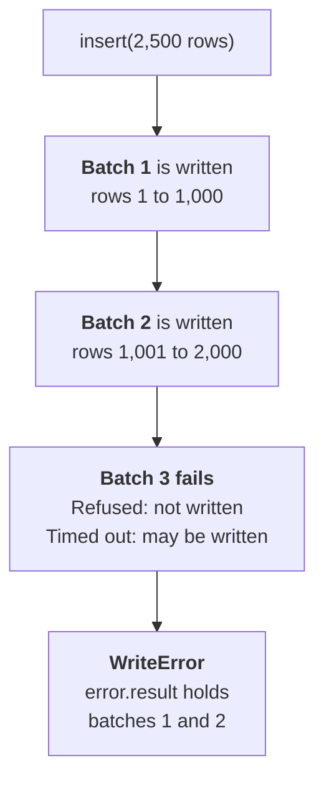

# Writing records

This page covers creating, updating, and deleting records, and what to do when rows fail.

```python
from pyquickbase import Quickbase

with Quickbase(realm="acme", token="your_user_token") as qb:
    tasks = qb.app("bq1234567").table("Tasks")
    result = tasks.insert([{"Title": "Pour slab"}])
    print(result.created_ids)
```

The other examples on this page use `tasks`, made in the same way, with the sync client. With the async
client, use `await` on each call.

| Method | What it does |
|---|---|
| `table.insert(records)` | Creates records, and never changes existing ones |
| `table.update(records)` | Changes records. Each one needs a `Record ID#` |
| `table.upsert(records, merge_on="Code")` | Updates the record whose unique field matches, or creates one |
| `table.delete(where)` | Deletes matching records and returns the count |

To choose between the three that write: use `update()` to change records you know by Record ID#,
`upsert()` to update or create by a unique field, and `insert()` to only create. `insert()` refuses a
table whose key field isn't Record ID#, so use `upsert()` with `merge_on` set to the key field there.

## Writing values

Rows are dictionaries keyed by field label or ID. [Field types](../field-types.md) lists what to write
for each type.

| Python value | What happens |
|---|---|
| `date` | Written as a date |
| `datetime` with a timezone | Written as a date and time, and reads back to the second. Without a timezone, it raises `InvalidValueError` |
| `Decimal` | Written exactly, so money doesn't pick up rounding errors |
| `str`, `int`, `float`, `bool`, `list`, or `dict` | Written as it is |
| `None` | Clears the field |
| `FileUpload` | Attaches a file. See [File attachments](files.md) |
| Anything else | Raises `InvalidValueError` |

## Creating records

```python
from datetime import date

result = tasks.insert(
    [
        {"Title": "Pour slab", "Status": "Not Started", "Due Date": date(2027, 1, 15)},
        {"Title": "Frame walls", "Status": "Not Started"},
    ]
)
print(result.created_ids)
```

`result.row_ids` holds each row's new Record ID#, in the order of your rows, with None for a row that
failed. `created_ids` leaves failed rows out, so it lines up with your rows only when none failed. A row
that sets `Record ID#` raises
`InvalidValueError`, because that would update a record.

### Tables with a custom key field

A table's key field is `Record ID#` unless someone has changed it in the Quickbase UI. If they have,
Quickbase [changes the record](../api-notes.md#writes) when a row has an existing value in that field,
rather than creating one, and there's no way to ask it to only create. So `insert()` raises
`InvalidValueError` on those tables, and sends nothing. Use `upsert()` instead, which updates a matching
record or creates one, and tells you which it did.

```python
print(tasks.info().key_field_id)  # 3 is Record ID#

result = tasks.upsert([{"Code": "A-100", "Title": "Pour slab"}], merge_on="Code")
print(result.created_ids, result.updated_ids)
```

## Updating records

Each row needs a `Record ID#`. Fields you leave out keep their values. A Record ID# that doesn't exist
is an error, not a new record. A record whose values didn't change is listed in `unchanged_ids`, not
`updated_ids`.

```python
result = tasks.update([{"Record ID#": 7, "Status": "Done", "Notes": None}])
print(result.updated_ids, result.unchanged_ids)
```

[Try it in the playground](../playground-app/index.html#change-records), with simulated data.

## Upserting records

`merge_on` must name a field marked as unique, and every row must set it. A row whose value doesn't
match any record **creates a new record**, so use `update()` if that isn't what you want. Repeating the
same write changes nothing, and lists the record in `unchanged_ids`.

```python
result = tasks.upsert([{"Code": "A1", "Title": "Frame walls"}], merge_on="Code")
print(result.created_ids, result.updated_ids)
```

## Writing a DataFrame

`insert()`, `update()`, `upsert()`, and `preview_update()` also take a pandas or polars DataFrame, with a
column named after each field, by label or ID. Each row is one record.

```python
import pandas as pd

frame = pd.DataFrame({"Title": ["Order chairs", "Book venue"], "Status": ["Open", "Open"]})
result = tasks.insert(frame)
print(result.created_ids)
```

- A missing value, such as `NaN`, `NaT`, or `None`, leaves the field empty in `insert()`, and clears it
  in `update()` and `upsert()`. Drop the column to leave a field as it is.
- The index isn't written. Use `reset_index()` to make it a column.
- A timestamp needs a timezone, as any `datetime` does, so convert a naive column with
  `tz_localize()` first.
- Rows are checked as dictionaries are, so a column that isn't a field raises `UnknownFieldError` and
  nothing is written.

## Deleting records

`where` is required, and it's checked before sending. This matters more here than anywhere else:
Quickbase treats a lowercase operator as "contains", so a typo could delete far more than you meant.
If nothing matches, it returns 0 rather than raising an error.

```python
from pyquickbase import F

deleted = tasks.delete(F("Status") == "Cancelled")
print(deleted)
```

[Try it in the playground](../playground-app/index.html#delete-records-safely), with simulated data.

## Previewing a write

`preview_update()` and `preview_delete()` show what a write would do, and change nothing. They only read,
so they work on a [read-only client](../policies/index.md#making-a-client-read-only).

`preview_update()` takes the same rows as `update()`:

```python
created = tasks.insert([{"Title": "Pour slab", "Status": "Open"}]).created_ids[0]

preview = tasks.preview_update([{"Record ID#": created, "Status": "Done", "Title": "Pour slab"}])
for change in preview.changes:
    for label, values in change.fields.items():
        print(change.record_id, label, values.before, "->", values.after)  # Only Status changes
print(preview.unchanged_ids, preview.missing_ids)
```

| Attribute | What it holds |
|---|---|
| `changes` | The records that would change, each with `{field label: FieldChange}`, which has `before` and `after` |
| `unchanged_ids` | The records that already hold these values |
| `missing_ids` | The records that don't exist, or that the token can't see |
| `events` | Active webhooks, Quickbase actions, email notifications, and automations on the table, which the update may set off |

An empty field reads as `None` in both `before` and `after`. A file field shows the file's name, and leaves
out its contents and who uploaded it. If a record is in several rows, a later row wins, as it would in
`update()`. A value counts as a change whenever the comparison isn't certain, so `update()` could still
report a listed record as unchanged, but a preview doesn't leave out a change it can detect.

`preview_delete()` takes the same `where` as `delete()`, checked the same way, and returns a page, so
`total` is how many records would be deleted, however many it returns:

```python
from pyquickbase import F

page = tasks.preview_delete(F("Status") == "Cancelled", select=["Title"], limit=25)
print(page.total, [task["Title"] for task in page.records])
```

Both previews list the table's active webhooks, Quickbase actions, email notifications, and
record-triggered automations in `events`, because changing records may set them off. Quickbase doesn't
say which changes set each one off, so some may not run. `events` is `None` when they couldn't be read,
such as when the token isn't an app administrator's.

```python
from pyquickbase import F

preview = tasks.preview_delete(F("Status") == "Cancelled")
for event in preview.events or ():
    print(event.type, event.name or event.url)
```

A preview can't promise what the write will do:

- **It's a snapshot.** A record can change between the preview and the write, as Quickbase has no
  transactions. Check `WriteResult` afterward.
- **It doesn't check whether Quickbase will accept the write.** A formula field, a value outside a field's
  choices, one of the table's data rules, or a role that can't edit a field all look like a normal change.
- **It doesn't check a client's policy.** A [policy](../policies/index.md) can still
  refuse the write that follows.

## What a write returns

`insert()`, `update()`, and `upsert()` return a `WriteResult`:

| Attribute | Meaning |
|---|---|
| `created_ids` | Record IDs of new records |
| `updated_ids` | Record IDs of records that changed |
| `unchanged_ids` | Record IDs of records whose values were already the same |
| `errors` | The rows that failed. This is only ever set on `WriteError.result`, because a failure raises |
| `row_ids` | For `insert()`, each row's new Record ID#, or None for a row that failed |

## When rows fail

Quickbase writes the rows it can and reports the rest, so a `WriteError` doesn't mean nothing
changed. Its `result` lists both what was written and what failed, and `index` is the row's position
in the list you passed. When a later batch of a large write fails, the error's `__cause__` is that
batch's own error, such as a `RateLimitError`.

```python
from pyquickbase import WriteError

try:
    tasks.insert(rows)
except WriteError as error:
    for row, record_id in zip(rows, error.result.row_ids):
        print(row, record_id)  # None for a row that failed
    for failed in error.result.errors:
        print(rows[failed.index], failed.messages)
```

`reason` says why a row failed, without you having to read Quickbase's wording, which can change:

| `reason` | Why the row failed |
|---|---|
| `duplicate` | A value is already in a unique field, which `field_id` names |
| `permission` | The token's role refused it |
| `invalid_choice` | A value isn't one of the field's choices, on a field with `allowNewChoices` off, and `field_id` names the field |
| `rule` | One of the table's custom data rules refused it, and `messages` holds the rule's text |
| `other` | Anything else, such as writing to a formula or built-in field, or wording this version doesn't recognize |

This makes a repeated insert easy to treat as already done, for a table a role can add to but not
change:

```python
try:
    movements.insert([{"Key": "order-7", "Quantity": -1}])
except WriteError as error:
    if any(failed.reason != "duplicate" for failed in error.result.errors):
        raise
```

A write refused by the role raises `WritePermissionError`, whichever way Quickbase reported it. See
[Errors](errors.md#refused-writes). **An upsert that matches an existing record needs permission to
modify**, so a role that can only add gets a refusal when a write is repeated.

[Try it in the playground](../playground-app/index.html#an-import-that-loses-a-row), with simulated data.

## Rows Quickbase could skip

A row needs at least one real value, so `insert()` and `upsert()` raise `InvalidValueError` for a row
where every value is empty. Quickbase can skip such a row without saying so, which also shifts
`created_ids` against your rows.

## Large writes

Large writes are split into batches of 1,000 rows, which you can change with `batch_size`. If a later
batch fails outright, `WriteError` is raised with the results so far. Check `error.result` before
trying again, so you don't write the same rows twice.



A write that times out, or gets a 502, 503, or 504, isn't retried, because Quickbase may already have
applied it. If batch 1 fails, its own error is raised, such as `RateLimitError`, except a 403, which is
still a `WritePermissionError`.

## When something is refused

| What happened | Exception | What's left behind |
|---|---|---|
| A row sets `Record ID#` in `insert()`, or leaves it out of `update()` | `InvalidValueError` | Nothing was sent |
| A row leaves out the `merge_on` field in `upsert()` | `InvalidValueError` | Nothing was sent |
| A row can't be sent in `preview_update()`, for the same reasons as `update()` | `InvalidValueError` | Nothing was read |
| `Record ID#` in `preview_update()` isn't a positive integer | `InvalidValueError` | Nothing was read |
| `preview_delete()` with a `where` that's None or can't be sent as written | `QueryError` | Nothing was read |
| A row has no real values in `insert()` or `upsert()` | `InvalidValueError` | Nothing was sent |
| `insert()` on a table whose key field isn't `Record ID#` | `InvalidValueError` | Nothing was sent |
| A value that can't be written, such as a `datetime` without a timezone | `InvalidValueError` | Nothing was sent |
| A row names a field the table doesn't have, or the token can't see | `UnknownFieldError` | Nothing was sent |
| `batch_size` below 1, or a `delete()` condition that can't be sent as written | `QueryError` | Nothing was sent |
| The client is read-only, or its [policy](../policies/index.md) doesn't allow this write | `PolicyRefusedError` | Nothing was sent, unless it's a later batch, below |
| `merge_on` isn't a unique field | `BadRequestError` | Nothing was written |
| Some rows failed, such as a duplicate or a formula field | `WriteError` | **The other rows were written** |
| A later batch failed outright, or a [rule of your own](../policies/custom-rules.md) refused it | `WriteError` | **Earlier batches were written** |
| The role refused the write | `WritePermissionError` | Check `error.result` for earlier rows |
| The request timed out | `RequestTimeoutError` | **It may have been applied.** It isn't retried |

See [Handling errors](errors.md) for how these exceptions relate.
