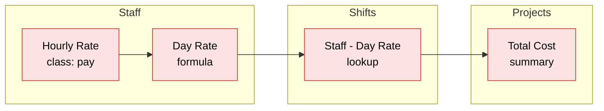

# Classes and new fields

## Classes, and what derived fields read

A class names a group of fields, such as everything about pay, for `fields.classed()`. Each entry is
`"Table.Field"`, `("Table", "Field")` when a name holds a dot, `fields.all()`, or
`fields.labeled_like(...)`, which matches in every table.

**A formula, lookup, or summary is in every class of the fields it reads,** through any chain of
them, including the fields a summary's filter uses. So `deny.all(fields.classed("pay"))` hides a
formula of `Hourly Rate`, a lookup of that formula on another table, and a summary of the lookup. A
formula that can't be read counts as reading every field of its table, and one that calls a function
that reads other records counts as reading every field of the app.

Every field in the chain is in `pay`, so `deny.all(fields.classed("pay"))` hides all four, on all
three tables.

**A new formula, lookup, or summary may only read what the client may read,** as anyone who can read
it sees what it shows. The SDK's methods check this before sending one, and `qb.request()` can't make
one.

## Fields added after binding

The bound policy holds every table and field by ID, as Quickbase never reuses a field's ID within a
table, so a rule can't come to mean another field. A renamed field keeps its rules until you bind
again. A field added after binding gets `new_fields`:

| `new_fields` | A new field is |
|---|---|
| `"read"`, the default | Read, filtered, and sorted wherever a rule reads `fields.all()` or `fields.new()` |
| `"hidden"` | Hidden |
| A class's name | In that class, so the rules for the class apply |

**A new field is never writable** until the policy is bound again, whatever the rules say.
