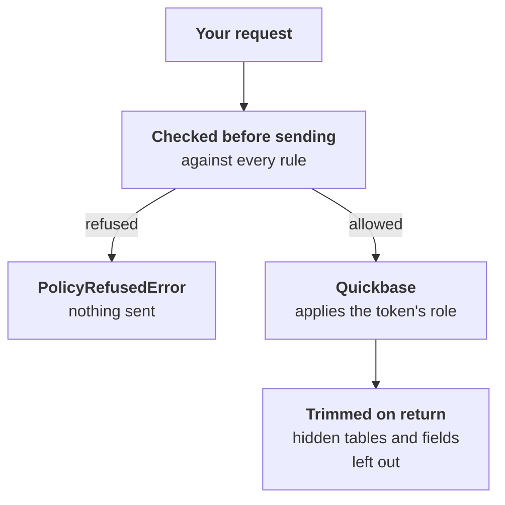
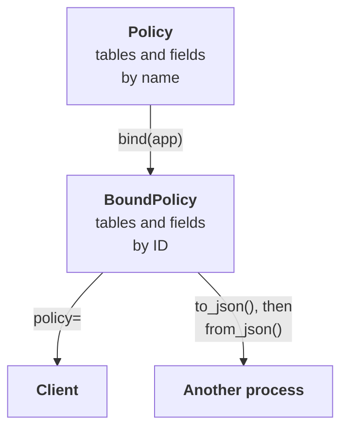

# Policies

A client takes one `policy`, which says what it may read and change.

| Policy | What the client can do | Use it for |
|---|---|---|
| None | Whatever the token can | Your own scripts |
| `Policy.read_only()` | Read whatever the token can, and change nothing | Reports, dashboards, and anything that only looks |
| `Policy(rules=[...])`, bound to an app | Only what its rules allow | An AI agent, or a job with a narrow purpose |

A policy protects against bugs in your code and mistakes by a model. See
[what it doesn't do](limits.md), and give your token access to as little as possible,
so that Quickbase enforces the limit too.

## How a policy decides

A policy works on both sides of each request, including one sent through `qb.request()`:



A table method may read the table's metadata before its own request is checked. A hidden table or
field looks as if it doesn't exist. When a request is refused, `error.decision.layer` says which check
refused it:

| `layer` | Refused because |
|---|---|
| `policy` | No rule allows it, or a deny rule covers it. A deny always wins |
| `rows` | A row limit can't be added to it, or it would show a row-limited table's records elsewhere |
| `derived` | A formula, lookup, or summary would read something the client can't |

A confirmation that `require_preview` asks for isn't part of the policy. A missing or mismatched one
raises `ConfirmationError`.

## Binding a policy

1. **Write a `Policy`** of rules, by table name and field label.
2. **Bind it to the app** once. Binding looks up every name, reports every problem at once, and
   pins each table and field by ID.
3. **Give the bound policy to a client.** From then on, every request is checked against it.



A bound policy holds tables and fields by ID, so renaming one doesn't change what a rule means. A
field added after binding follows `new_fields` until you bind again, and a table the client creates
gives it a new policy, `qb.policy`, that includes it.

## Making a client read-only

`Policy.read_only()` guarantees a client can't change data. It only sends GET requests, record
queries, report runs, and formula runs, and reads them as a client without a policy would. Running a
report adds to its usage count in Quickbase, but changes no records. It names no table, so a client
takes it without binding.

It doesn't cover everything a token can read. A client with any policy, including this one, can't list apps, ask who
a token belongs to, look up users, or read an app's members or their roles, because those aren't about one app's tables.
Use a client without a policy for those.

```python
from pyquickbase import Policy, Quickbase

with Quickbase(realm="acme", token="your_user_token", policy=Policy.read_only()) as qb:
    print(qb.app("bq1234567").tables())
```
