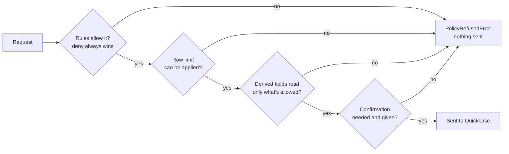

# Policies

A client takes one `policy`, which says what it may read and change. Every request is checked
before it's sent, including through `qb.request()`. A refused one raises `PolicyRefusedError`, and
nothing is sent, though a table method may read the table's metadata first. What the policy hides is
left out of every response, so a hidden table or field acts as if the token couldn't see it.

| Policy | What the client can do | Use it for |
|---|---|---|
| None | Whatever the token can | Your own scripts |
| `Policy.read_only()` | Read whatever the token can, and change nothing | Reports, dashboards, and anything that only looks |
| `Policy(rules=[...])`, bound to an app | Only what its rules allow | An AI agent, or a job with a narrow purpose |

A policy protects against bugs in your code and mistakes by a model. See
[what it doesn't do](limits.md), and give your token access to as little as possible,
so that Quickbase enforces the limit too.

## How a policy decides

Every request a client sends goes through the same checks, in order, before anything reaches
Quickbase. The first check that refuses it stops it, and nothing is sent.



Each check is a `layer` on the `Decision` it makes: `policy`, `rows`, `derived`, or
`confirmation`. What the policy hides is also left out of every response, so a hidden table or
field looks as if it doesn't exist.

1. **Write a `Policy`** of rules, by table name and field label.
2. **Bind it to the app** once. Binding looks up every name, reports every problem at once, and
   pins each table and field by ID.
3. **Give the bound policy to a client.** From then on, every request is checked against it.

## Making a client read-only

`Policy.read_only()` guarantees a client can't change data. It only sends GET requests, record
queries, report runs, and formula runs, and reads them as a client without a policy would. Running a
report adds to its usage count in Quickbase, but changes no records. It names no table, so a client
takes it without binding.

```python
from pyquickbase import Policy, Quickbase

with Quickbase(realm="acme", token="your_user_token", policy=Policy.read_only()) as qb:
    print(qb.app("bq1234567").tables())
```
