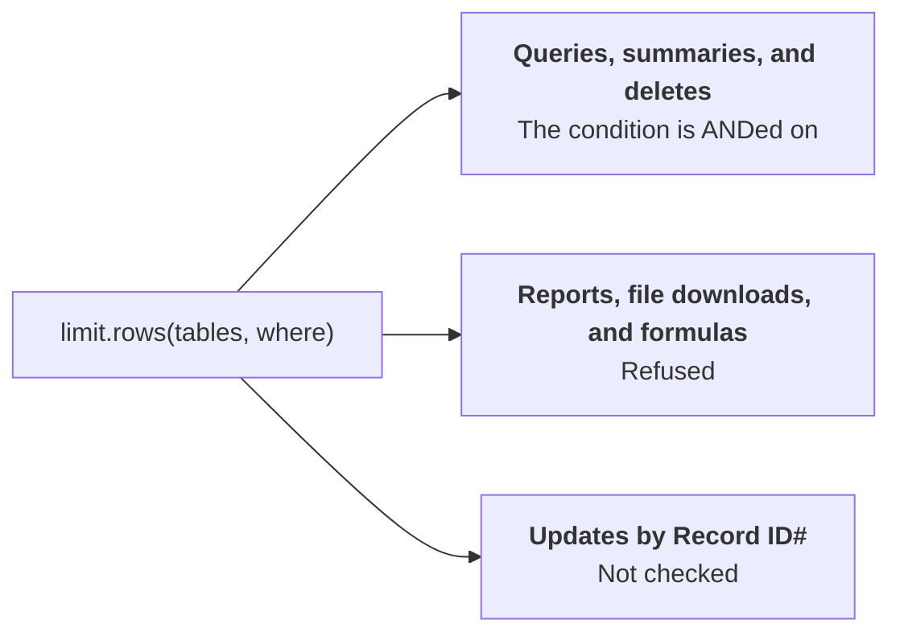

# Limiting rows

`limit.rows(tables, where)` ANDs a condition onto every query, summary, and delete the client sends
to those tables, including through `qb.request()`. The fields it uses may be filtered on.

- **A summary over a row-limited table gets the limit in its filter,** so `ensure_summary_field()`
  and a plan's summaries count only what the client may reach.
- **An existing summary of a row-limited table whose filter doesn't hold the limit is hidden,** as
  is a lookup from a row-limited table, which shows its records on others. A lookup onto a
  row-limited table is fine.
- **Reports, file downloads, and formulas on a row-limited table are refused,** as the limit can't be
  added to them.
- **It doesn't check updates by `Record ID#`,** which name a record without a filter.

It's defense in depth. Quickbase's [record-level rules](../api-notes.md#record-level-rules) for the
token's role are the real boundary, so set those as well.
