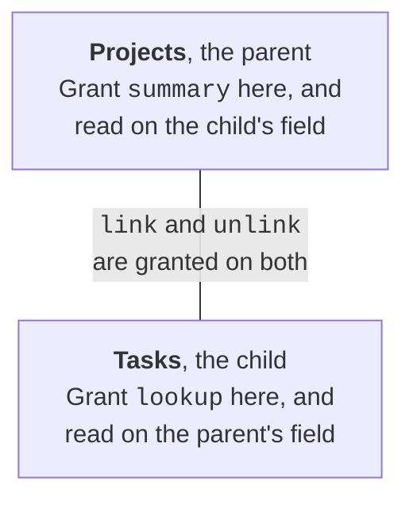

# Writing rules

A policy is a list of rules over tables and fields, by name and label. Bind it to the app once,
which looks up every name and reports every problem at once, then give the bound policy to the
client.

```python
from pyquickbase import F, Policy, Quickbase, allow, deny, fields, limit, tables

policy = Policy(
    tags={
        "pay": ["Tasks.Amount"],
        "internal": [("Tasks", "Code"), fields.labeled_like("Old*")],
    },
    rules=[
        allow.read(tables.all(), max_paging_depth=50),
        allow.insert("Tasks", fields.all()),
        allow.update("Tasks", ["Status", "Due Date", "Notes"]),
        allow.delete("Tasks", max_records_per_delete=3),
        limit.rows("Tasks", F("Project") == "Roof"),
        deny.all(fields.tagged("pay", "internal")),
    ],
)

with Quickbase(realm="acme", token="your_user_token") as setup:
    bound = policy.bind(setup.app("bq1234567"))

with Quickbase(realm="acme", token="your_user_token", policy=bound) as qb:
    tasks = qb.app("bq1234567").table("Tasks")
    tasks.update([{"Record ID#": 1, "Status": "Done"}])  # Allowed
    # tasks.update([{"Record ID#": 1, "Amount": 90}])  # Raises PolicyRefusedError
```

With the async client, it's `await policy.bind(app)`. Bind with a client that has no policy, so it
can see every table and field.

**Anything no rule allows is refused, and a deny always wins.** Each rule names its tables first:
a table's name or ID, a list of them, [`tables.all()`](../reference/rules.md#tables-all) for every table in the app and any the client
creates, or [`tables.created()`](../reference/rules.md#tables-created) for only those the client creates. Most then name fields: labels or
IDs, [`fields.all()`](../reference/rules.md#fields-all), [`fields.new()`](../reference/rules.md#fields-new) for fields added after binding, `fields.tagged(...)`, or
`fields.labeled_like(...)`, which matches labels such as `_*`, ignoring case.

| Rule | What it allows |
|---|---|
| `allow.read(tables, fields, ...)` | Reading the fields, and filtering and sorting by them, unless it gives its own `filter=` or `sort=`. It also takes `max_paging_depth`, `max_records_scanned`, and `user_emails` |
| `allow.filter(...)`, `allow.sort(...)` | Filtering or sorting by fields without reading them |
| `allow.insert(...)`, `allow.update(...)` | Setting the fields in new or existing records. An upsert needs both |
| `allow.delete(tables, max_records_per_delete=None)` | Deleting records. With `max_records_per_delete`, the client counts what matches first |
| `allow.download(...)`, `allow.delete_file(...)` | Downloading files, or deleting their versions |
| `allow.report(table, reports)` | Running these reports, by name or ID, or every report with `None` |
| `allow.schema(tables, *verbs, ...)` | Changing the schema, as [below](#schema-changes) |
| [`allow.create_tables()`](../reference/rules.md#allow-create_tables) | Creating tables in the bound app |
| `allow.code_pages(write=False)` | Reading the app's code pages, and with `write=True`, creating and replacing them. See [below](#code-pages) |
| `deny.all(selector)`, `deny.read(...)`, `deny.update(...)`, and the rest | Refusing what they name, whatever allows it |
| `limit.rows(tables, where)` | Reaching only the records that match, as [below](#limiting-rows) |

Things to know:

- **Writing a field doesn't need read access to it,** so a client can set a field it can't see.
  Such a field can still be named, but its values aren't returned.
- **`Record ID#` is readable wherever anything is,** because the SDK uses it to page through records.
- **`max_paging_depth` limits each query, not the client.** A query needs a `limit` of at most this, and
  it's refused rather than cut short. Where several rules read a table, the highest applies. It
  defaults to 100, and `max_records_scanned` to 10,000. A summary that only counts reads no records,
  so `max_records_scanned` doesn't limit it.
- **A field you may filter or sort by reveals something about its values,** even if it isn't
  returned, because a model can see which records match and in which order.
- **A report's own filter and sort can use any field,** and someone can change them in the Quickbase
  interface, so list only reports you've checked. A summary report's columns can't be matched to
  fields, so allowing one shows all of them.
- **Some things are refused unless the policy is [`Policy.read_only()`](../reference/policies.md#Policy-read_only):** running a formula, which can
  read any table, an app's details and roles, and any request it doesn't recognize. Use a separate
  client for those.
- **A delete needs `filter` on the fields its filter uses,** because the number deleted shows how
  many records matched.
- **Roles can't be allowed.** No policy can list who holds a role, or change it, as an agent that could change
  roles could give itself anything the policy withholds. Use a client without a policy.
- **`insert` alone can't be limited to creating records on a table with a custom key field.** If
  someone has changed a table's key field, a row with an existing value in that
  field [changes that record](../api-notes.md#writes). [`table.insert()`](../reference/writes.md#Table-insert) refuses those tables, so use
  [`upsert()`](../reference/writes.md#Table-upsert), which needs both `insert` and `update`. [`qb.request()`](../reference/client.md#Quickbase-request) can't look up a table's key
  field, so any write through it without a merge field needs both.

## Limiting rows

`limit.rows(tables, where)` keeps a client to the records of those tables that match a condition:

| Request | What [`limit.rows()`](../reference/rules.md#limit-rows) does |
|---|---|
| Queries, summaries, and deletes, including through [`qb.request()`](../reference/client.md#Quickbase-request) | ANDs the condition onto them |
| A filter on a field the condition uses | Allows it, unless a deny rule covers the field |
| A new summary or count field, from an `ensure_` method or a plan | Gets the limit in its filter |
| An existing summary whose filter doesn't hold the limit | Hidden |
| A lookup from a row-limited table | Hidden, and a new one is refused |
| A lookup onto a row-limited table | Allowed |
| Reports, file downloads, deleting file versions, and formulas | Refused |
| Updates by `Record ID#`, including through `qb.request()` | Checks first that every record matches, with one query per 100 records, and refuses the batch if any doesn't |
| Upserts | Refused, since they can change any record their key matches |
| Inserts | Not checked |

The check before an update can't stop a record that someone else changes between the check and the write,
and an update may change a field the condition uses, which moves the record outside the limit.

It's defense in depth. Quickbase's [record-level rules](../api-notes.md#record-level-rules) for the
token's role are the real boundary, so set those as well.

## Schema changes

`allow.schema(tables, *verbs)` grants schema changes on the table where each change lands:

| Verb | What it allows | Granted on |
|---|---|---|
| `create_field` | Adding fields, of `field_types=[...]` if given | The table |
| `update_field`, `delete_field` | Changing or deleting the fields in `fields=`, or every field | The table |
| `formula` | Making or changing a formula, with `create_field` or `update_field` | The table |
| `lookup` | Adding a lookup, which also needs `read` on the parent's field | The child |
| `summary` | Adding a summary, which also needs `read` on the child's field, and `filter` on every field its filter uses | The parent |
| `link`, `unlink` | Making or deleting a relationship | **Both tables**, as Quickbase adds a link field and an "Add" record formula to the parent. `unlink` also needs `delete_field` wherever its lookups and summaries are |
| `update_table`, `delete_table` | Renaming the table, or deleting it and its records | The table |
| `set_key_field` | Changing which field is the table's key, with a [`SetKeyField`](../reference/schema-plans.md#SetKeyField) change | The table |

For a relationship, the grant goes where the new field appears:



A formula can't make a link or rich text (`url` or `rich-text`), as that acts as whoever clicks it. For the
same reason, no rule lets a client turn on a field's `allowHTML` property, which shows its values as markup.

**Creating a table gives the client a new policy,** with the table in its `created` list, so that
[`tables.created()`](../reference/rules.md#tables-created) covers it. [`qb.policy`](../reference/client.md#Quickbase-policy) is always the current one, and nothing is changed in place.
Save it with `qb.policy.to_json()` to use in another process, and load it with
[`BoundPolicy.from_json()`](../reference/policies.md#BoundPolicy-from_json).

## Code pages

[`allow.code_pages()`](../reference/rules.md#allow-code_pages) lets a client list and read an app's code pages, and `allow.code_pages(write=True)` lets it
create and replace them too. A client with any other policy, including [`Policy.read_only()`](../reference/policies.md#Policy-read_only), is refused.

!!! danger "A policy doesn't limit what a page does"
    A code page runs in the viewer's browser, with the viewer's permissions. A policy controls what this client may
    do. It doesn't control what a page does once someone opens it. Allowing page writes lets the writer run code as
    anyone who views that page, including an administrator, who could change roles or read fields this policy hides.
