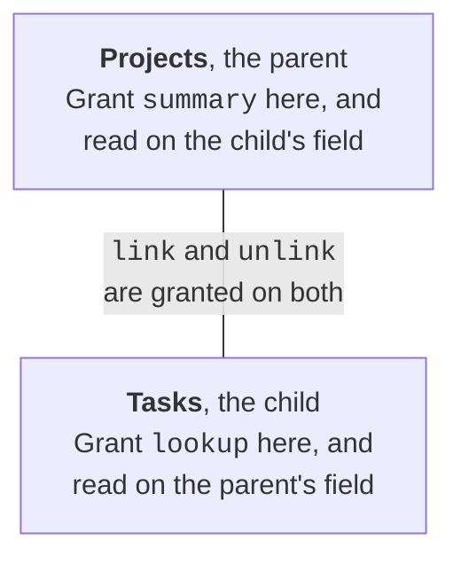

# Schema changes

`allow.schema(tables, *verbs)` grants schema changes on the table where each change lands:

| Verb | What it allows | Granted on |
|---|---|---|
| `create_field` | Adding fields, of `field_types=[...]` if given | The table |
| `update_field`, `delete_field` | Changing or deleting the fields in `fields=`, or every field | The table |
| `formula` | Making or changing a formula, with `create_field` or `update_field` | The table |
| `lookup` | Adding a lookup, which also needs `read` on the parent's field | The child |
| `summary` | Adding a summary, which also needs `read` on the child's field, and `filter` on every field its filter uses | The parent |
| `link`, `unlink` | Making or deleting a relationship | **Both tables**, as Quickbase adds a link field and an "Add" record formula to the parent. `unlink` also needs `delete_field` wherever its lookups and summaries are |
| `update_table`, `delete_table` | Renaming the table, or deleting it and its records | The table |
| `set_key_field` | Changing which field is the table's key, with a `SetKeyField` change | The table |

For a relationship, the grant goes where the new field appears:

A formula can't make a link or rich text (`url` or `rich-text`), as that acts as whoever clicks it. For the
same reason, no rule lets a client turn on a field's `allowHTML` property, which shows its values as markup.

**Creating a table gives the client a new policy,** with the table in its `created` list, so that
`tables.created()` covers it. `qb.policy` is always the current one, and nothing is changed in place.
Save it with `qb.policy.to_json()` to use in another process, and load it with
`BoundPolicy.from_json()`.
