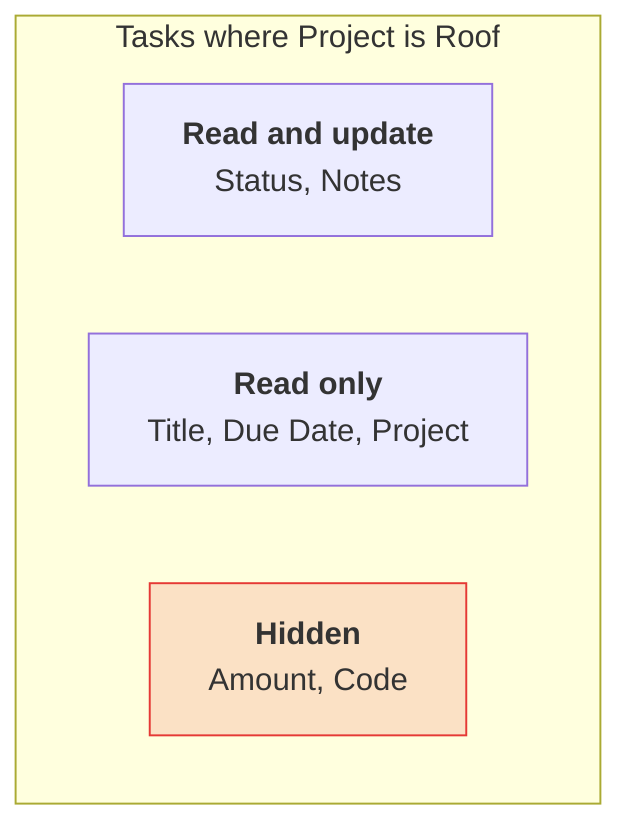

# Your first policy

This builds a policy for an agent that helps a crew keep their tasks up to date, one step at a
time. The app has a `Tasks` table with `Title`, `Status`, `Notes`, `Due Date`, `Project`, `Amount`,
which holds what a task costs, and `Code`, an internal reference.

Each step asks the bound policy what it allows, with `allows()` and `explain()`, which send nothing.

## 1. Start read-only

`Policy.read_only()` reads whatever the token can and changes nothing. It names no table, so it needs
no binding. Start here, and loosen it only where the job needs to.

```python
from pyquickbase import Policy, Quickbase

with Quickbase.from_env(policy=Policy.read_only()) as qb:
    tasks = qb.app("bq1234567").table("Tasks")
    for task in tasks.query(select=["Title"], max_total=3):
        print(task["Title"])
```

## 2. Allow what the job needs

The agent reads tasks and changes their status and notes. Anything no rule allows is refused.

```python
from pyquickbase import Policy, Quickbase, allow

policy = Policy(
    rules=[
        allow.read("Tasks", max_paging_depth=50),
        allow.update("Tasks", ["Status", "Notes"]),
    ]
)
with Quickbase.from_env() as setup:
    bound = policy.bind(setup.app("bq1234567"))

print(bound.allows("update", "Tasks", field="Status").allowed)  # True
print(bound.allows("update", "Tasks", field="Due Date").allowed)  # False
```

A decision is also true or false by itself, so `if bound.allows("update", "Tasks", field="Status"):`
means what it says.

`max_paging_depth=50` means one query can reach at most 50 records, so a mistake can't page through the
whole table.

## 3. Hide what it shouldn't see

Costs and internal codes aren't the agent's business. Put them in a tag and deny the tag.
A deny always wins over an allow, and a formula, lookup, or summary that reads a denied field is
denied too.

```python
from pyquickbase import Policy, Quickbase, allow, deny, fields

policy = Policy(
    tags={"internal": ["Tasks.Amount", "Tasks.Code"]},
    rules=[
        allow.read("Tasks", max_paging_depth=50),
        allow.update("Tasks", ["Status", "Notes"]),
        deny.all(fields.tagged("internal")),
    ],
)
with Quickbase.from_env() as setup:
    bound = policy.bind(setup.app("bq1234567"))

print(bound.allows("read", "Tasks", field="Amount").allowed)  # False
print(bound.allows("read", "Tasks").allowed)  # False, since it covers every field
print(bound.explain("read", "Tasks", field="Amount"))
```

With no field, `allows()` and `explain()` ask about every field in the table, so the whole table is
no longer readable once any field is denied.

To a client with this policy, `Amount` and `Code` look as if they don't exist.

## 4. Keep it to some records

`limit.rows()` ANDs a condition onto every query, summary, and delete, and checks the records an update
names, so the agent only reaches one project's tasks.

```python
from pyquickbase import F, Policy, Quickbase, allow, deny, fields, limit

policy = Policy(
    tags={"internal": ["Tasks.Amount", "Tasks.Code"]},
    rules=[
        allow.read("Tasks", max_paging_depth=50),
        allow.update("Tasks", ["Status", "Notes"]),
        deny.all(fields.tagged("internal")),
        limit.rows("Tasks", F("Project") == "Roof"),
    ],
)
with Quickbase.from_env() as setup:
    bound = policy.bind(setup.app("bq1234567"))
print(bound.row_limit(setup.app("bq1234567").table("Tasks").info().id))
```

The agent now sees the `Tasks` table like this:



## 5. Use it

Give the bound policy to the agent's client. A refused request raises `PolicyRefusedError` before
anything is sent, and its message says what would allow it, so you can return it to the model as the
tool's result.

```python
from pyquickbase import Policy, PolicyRefusedError, Quickbase, allow

policy = Policy(rules=[allow.read("Tasks"), allow.update("Tasks", ["Status", "Notes"])])
with Quickbase.from_env() as setup:
    bound = policy.bind(setup.app("bq1234567"))

with Quickbase.from_env(policy=bound) as qb:
    tasks = qb.app("bq1234567").table("Tasks")
    tasks.update([{"Record ID#": 1, "Status": "Done"}])  # Allowed
    try:
        tasks.update([{"Record ID#": 1, "Due Date": None}])
    except PolicyRefusedError as error:
        print(error.decision.hint)
```

Next, see [Writing rules](rules.md) for every rule, and [Recipes](recipes.md) for complete policies.
